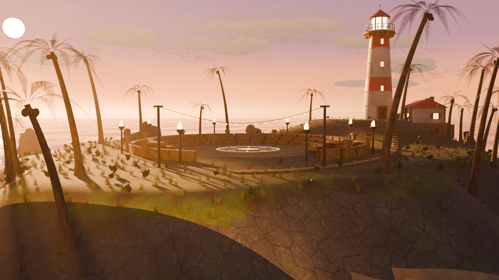
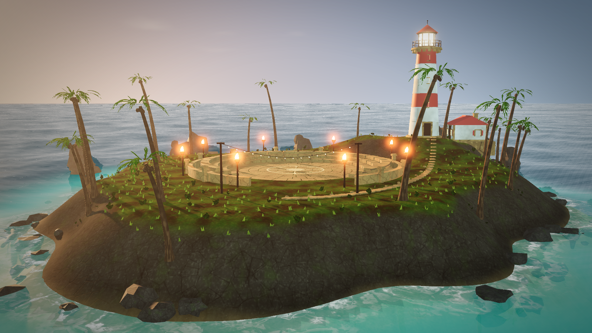
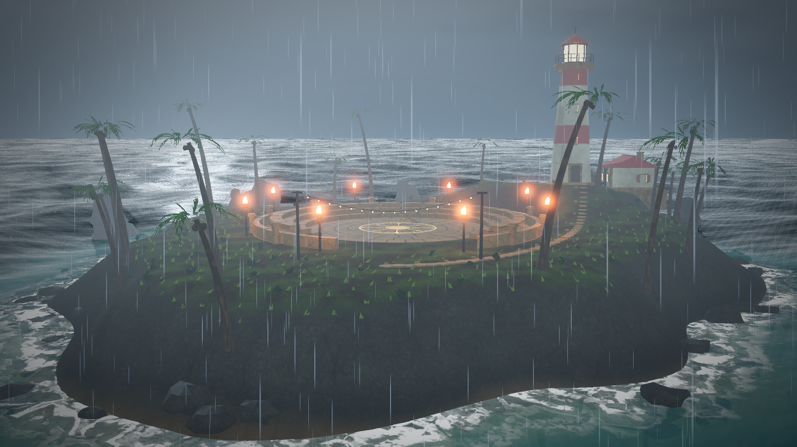
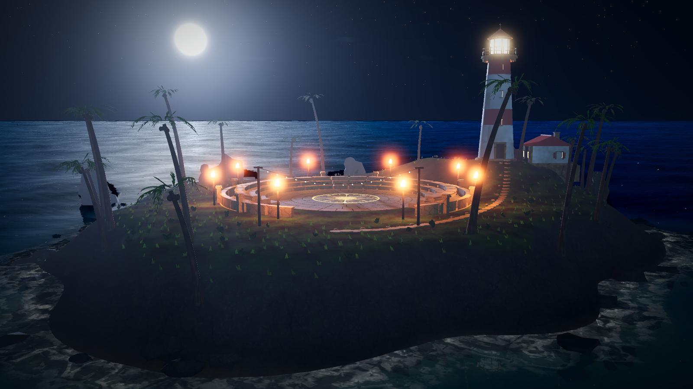
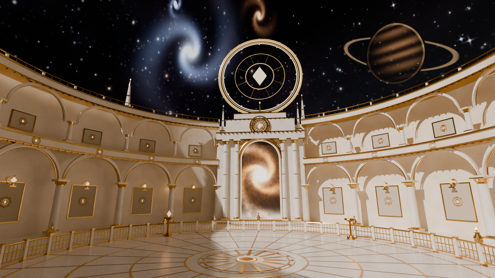
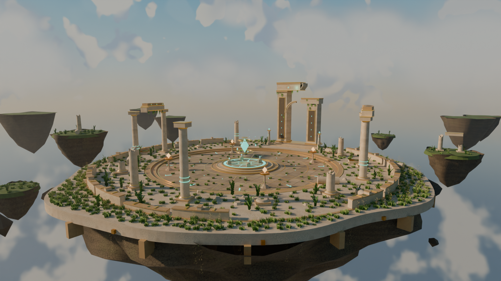
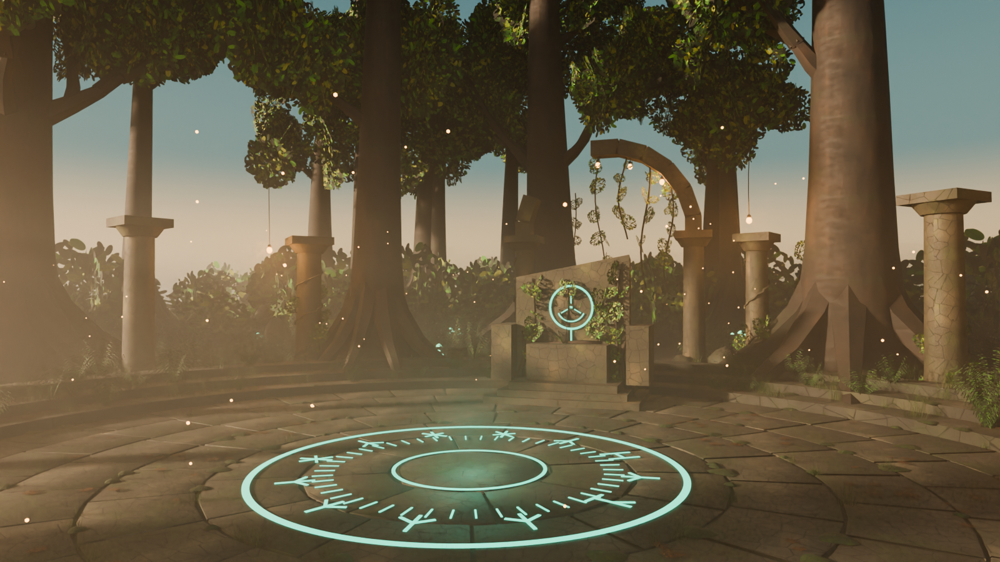

# 程序化竞技场场景生成器

Blender 5.2 → GLB → Godot 的竞技场场景工具。共用引擎在 `arena_kit/`，每个场景是一份 `scenes/<name>/scene.py` 参数表；需要动态环境的场景另配一个 `godot/<name>/` 实时工程。

## 热带海岛竞技场 · 实时

一座建立在热带海岛上的圆形竞技场：环形的石质看台、灯塔与看守小屋、成片的棕榈和礁石，被浅滩与沙滩环绕。Blender 侧程序化生成岛屿地形、建筑、植被与材质，导出为单文件自包含 GLB；Godot 侧在此之上叠加波形海面、平面反射、岸边泡沫、程序化天空与云层、风力植被，以及晴天 / 暴雨 / 夜晚三套可平滑切换的天气。



*Blender Cycles 离线渲染的静态场景主视觉；Godot 实时版另含动态海浪、水面反射、雨与闪电。*

| 部分 | 位置 |
|---|---|
| Blender 场景源码 | `scenes/island_arena/` |
| 生成物与导入说明 | `output/island_arena/README_Godot.md` |
| Godot 4.7 实时工程 | [godot/island_arena/README.md](godot/island_arena/README.md) |

实时工程操作：拖动旋转、滚轮缩放，`1` / `2` / `3` 切换晴天 / 暴雨 / 夜晚，`R` 随机天气，`C` 自动环绕。

### 实时天气与时间

三套天气共用同一套光照、雾、海面和风力参数，切换时约 4 秒平滑过渡。以下截图来自 Godot 实机（1600×900）：

| 晴天 | 暴雨 | 夜晚 |
|:--:|:--:|:--:|
| [](renders/island_arena/godot_sunny.png) | [](renders/island_arena/godot_storm.png) | [](renders/island_arena/godot_night.png) |
| 暖色天光、平静海面与浅滩 | 雨幕、涌浪与压暗的天光，闪电随机触发 | 月光、星空、火把串灯与旋转的灯塔光束 |

## 星空竞技场 · 静态

悬浮在深空中的古典竞技场：象牙白大理石广场由两层二十跨的金色拱廊围合，北侧是带星云传送门的凯旋门式门楼，门楣上方悬浮着直径 12.2 m 的金色光环与水晶；广场铺金线放射纹，环形栏杆立着鎏金瓮，四角燃着火盆。半径 92 m 的星空穹顶里预烘焙了螺旋星系、伴星系、带环行星与银河带。所有内容一次性导出为 GLB，无运行时依赖。



*Blender Cycles 离线渲染；星穹与星系是 GLB 内的发光几何，Godot 导入后配合环境补光、Glow 与 ReflectionProbe 即可。*

| 部分 | 位置 |
|---|---|
| Blender 场景源码 | `scenes/star_arena/` |
| 生成物与导入说明 | `output/star_arena/README_Godot.md` |

## 天空竞技场 · 静态

悬在云海之上的古代遗迹竞技场：断裂的环形柱廊、半塌的天空之门、中央悬浮的青绿心晶，脚下是破碎的浮空岩体；四周散布 5 座近景浮岛与 6 座远景浮岛。半径 240 m 的天空穹顶预烘焙了暖色地平线、积云、太阳与云海，全部内容一次性导出为 GLB，无运行时依赖。



*Blender Cycles 离线渲染；天空、云海与浮岛都是 GLB 内的几何，Godot 导入后配合环境补光、Glow 与 ReflectionProbe 即可。*

| 部分 | 位置 |
|---|---|
| Blender 场景源码 | `scenes/sky_arena/` |
| 生成物与导入说明 | `output/sky_arena/README_Godot.md` |

## 精灵森林竞技场 · 静态

隐藏在巨型古树之间的圆形石质竞技场：三层看台围合中央广场，外圈是一组残破的石柱廊，地面刻着发光的符文圆环，正对祭坛石碑；藤蔓、垂灯与萤火虫散布在林间，低角度暖阳穿过树干，在薄雾中拉出长影。场景由 Blender 完整生成并导出 GLB，符文、灯笼、蘑菇和萤火虫的自发光与点光一并保留。



*Blender Cycles 离线渲染；GLB 导入 Godot 后保留符文自发光、灯笼点光与相机。*

| 部分 | 位置 |
|---|---|
| Blender 场景源码 | `scenes/elven_arena/` |
| 生成物 | `output/elven_arena/` |
| Godot 导入与推荐 WorldEnvironment | `output/elven_arena/README_Godot.md` |

## 快速开始

```bash
# 列出场景
blender -b -P build.py -- --list-scenes

# 构建海岛：地形 → 竞技场 → 植被 → 灯光 → 导出 → 预览
blender -b -P build.py -- --scene island_arena --phase all --render mid

# 构建精灵森林竞技场
blender -b -P build.py -- --scene elven_arena --phase all --render mid

# 构建星空竞技场
blender -b -P build.py -- --scene star_arena --phase all --render mid

# 构建天空竞技场
blender -b -P build.py -- --scene sky_arena --phase all --render mid

# 运行海岛的 Godot 实时工程
"D:/software/Godot_v4.7.2/Godot_v4.7.2-stable_win64.exe" --path godot/island_arena
```

- 新建场景：复制 `scenes/_template` → 改 `scene.py` → 构建
- 完整工作流、参数说明、技术坑与验证清单：[GUIDE.md](GUIDE.md)
